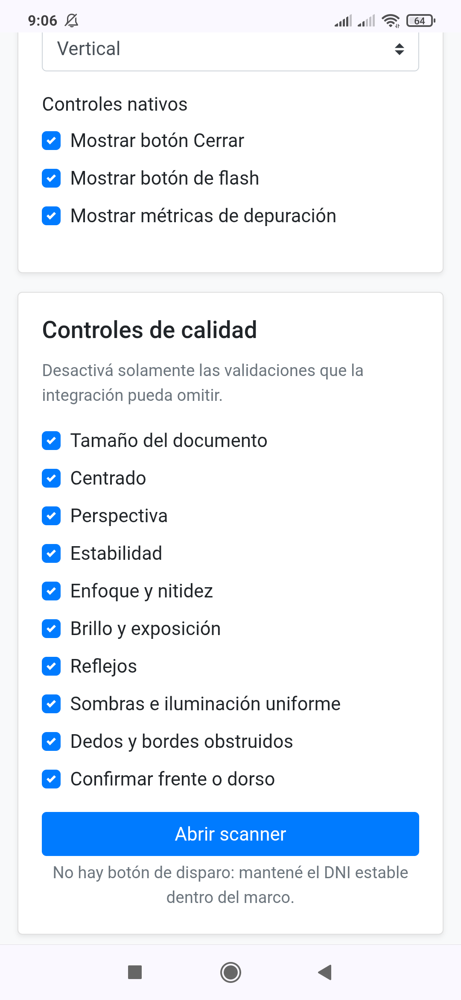
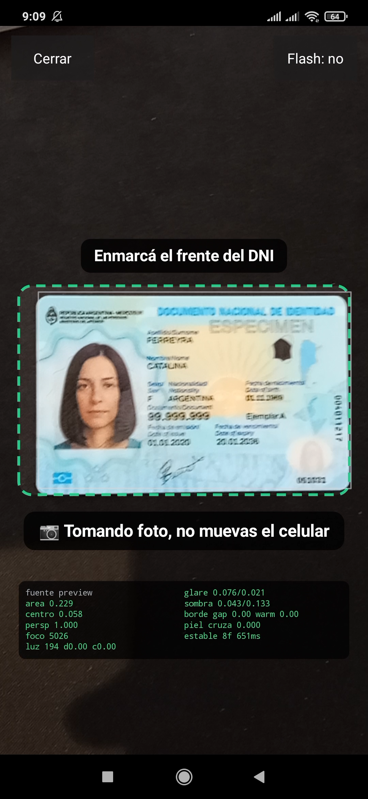
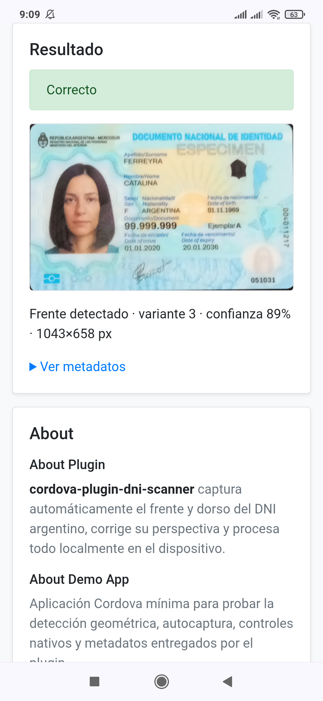
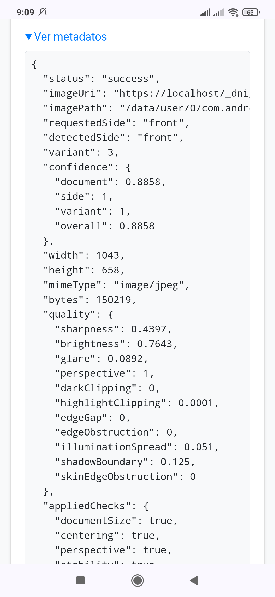

 

# cordova-plugin-dni-scanner

Android Cordova plugin for automatic capture of the front or back of an Argentine DNI. It detects the card geometrically, evaluates capture quality, corrects perspective, and returns a cropped color JPEG. Processing is fully local and works offline; the plugin does not use Google services, ML Kit, Firebase, OpenCV, ZXing, analytics, or remote APIs.

> Status: functional implementation under active calibration. It has been exercised on Samsung J7, Samsung S7, and Xiaomi devices, but recognition and quality thresholds should be validated with a representative DNI and device sample before production use.

## Table of contents

- [Screenshots](#screenshots)
- [Compatibility](#compatibility)
- [Installation](#installation)
- [Usage](#usage)
  - [Options](#options)
  - [Optional checks](#optional-checks)
- [Result](#result)
  - [Metadata](#metadata)
- [Cancellation, retries, and errors](#cancellation-retries-and-errors)
- [Architecture and behavior](#architecture-and-behavior)
- [Dependencies and licenses](#dependencies-and-licenses)
- [Privacy](#privacy)
- [Known limitations](#known-limitations)
- [Tests](#tests)
- [Changelog](#changelog)

## Screenshots

<table>
  <tr>
    <td align="center"><br><sub>Configurable quality controls</sub></td>
    <td align="center"><br><sub>Native automatic capture</sub></td>
  </tr>
  <tr>
    <td align="center"><br><sub>Corrected image and recognition result</sub></td>
    <td align="center"><br><sub>Result metadata</sub></td>
  </tr>
</table>

## Compatibility

The plugin supports `cordova-android` 11 through 15 from one codebase. It selects an exact CameraX version from the installed `cordova-android` major version, not from an overridable `compileSdk` value.

| cordova-android | CameraX | Reference toolchain |
| --- | --- | --- |
| 11.x | 1.1.0 | compileSdk 32 / AGP 7.2.1 / JDK 11 |
| 12.x | 1.2.3 | compileSdk 33 / AGP 7.4.2 / JDK 11 |
| 13.x | 1.4.2 | compileSdk 34 / AGP 8.3.0 / JDK 17 |
| 14.x | 1.5.2 | compileSdk 35 / AGP 8.7.3 / JDK 17 |
| 15.x | 1.6.0 | compileSdk 36 / AGP 8.10.1 / JDK 17 |

Unknown toolchain combinations fail at build time rather than silently selecting an unsafe dependency version. The plugin is Android-only.

## Installation

Install from npm:

```bash
cordova plugin add cordova-plugin-dni-scanner
```

Or install directly from GitHub:

```bash
cordova plugin add https://github.com/andreszs/cordova-plugin-dni-scanner.git
```

The plugin requests only `CAMERA`. Images are written to the application's private cache, so no storage permission is required.

## Usage

`DniScanner.scan(options)` returns a Promise:

```javascript
const result = await DniScanner.scan({
    side: "front",
    orientation: "portrait",
    flashMode: "off",
    showCloseButton: true,
    showFlashButton: false,
    debugMode: false,
    maxOutputLongEdge: 1280,
    guideMarginPercent: 3,
    instructionText: "Ubicá el frente del DNI en el recuadro",
    checks: {
        glare: true,
        shadows: true,
        edgeOcclusion: true,
        moire: false,
        requestedSide: true
    },
    timeoutMs: 45000
});

if (result.status === "cancelled") {
    return;
}

document.querySelector("img").src = result.imageUri;
```

Use `side: "back"` to capture the back.

### Options

| Option | Type | Default | Description |
| --- | --- | --- | --- |
| `side` | `"front" \| "back"` | required | Requested DNI side. |
| `autoCapture` | `boolean` | `true` | Only `true` is currently supported. |
| `orientation` | `"portrait" \| "landscape"` | `"portrait"` | Scanner orientation for this session. |
| `flashMode` | `"off" \| "auto" \| "on"` | `"off"` | Initial flash mode. `on` uses the torch; `off` is recommended to reduce reflections. |
| `showCloseButton` | `boolean` | `true` | Shows the native close button. Android Back still cancels when hidden. |
| `showFlashButton` | `boolean` | `true` | Shows the flash selector when the device has a flash unit. |
| `debugMode` | `boolean` | `true` | Shows preview/final-image metrics over the camera. It does not change validation. |
| `maxOutputLongEdge` | integer `640–2048` | `1280` | Maximum long edge of the corrected JPEG. The actual image may be smaller when the capture contains fewer effective pixels. |
| `guideMarginPercent` | number `0–20` | `3` | Permitted outward margin around the dotted guide, measured as a percentage of the guide's shorter edge. Candidates extending farther are ignored. |
| `instructionText` | `string \| null` | `""` | Optional text above the guide. Missing, empty, or `null` hides it. |
| `checks` | `object \| null` | standard checks enabled | Enables or disables individual acceptance checks. Missing properties stay enabled except `moire`, which defaults to `false`. |
| `timeoutMs` | integer `>= 0` | `0` | Maximum session duration. Zero disables the timeout. |

Only one scan may run at a time.

### Optional checks

`checks` accepts these boolean properties:

| Check | Purpose |
| --- | --- |
| `documentSize` | Rejects a card that is too close or too far. |
| `centering` | Requires the card near the guide. |
| `perspective` | Limits perspective distortion. |
| `stability` | Requires stable corners and scale across frames. |
| `sharpness` | Rejects blur using Laplacian variance. |
| `brightness` | Rejects under/overexposure and severe clipping. |
| `glare` | Rejects large localized reflections. |
| `shadows` | Rejects strong uneven illumination. |
| `edgeOcclusion` | Rejects interrupted edges and likely fingers/hands. |
| `moire` | Rejects broad periodic interference consistent with photographing a display. Defaults to `false`; its diagnostic metrics are still returned. |
| `requestedSide` | Requires `detectedSide` to match `side`. |

Four-corner document detection is always required for cropping and perspective correction. Disabling a check reduces capture guarantees.

## Result

A successful scan resolves with metadata and a temporary JPEG:

```json
{
  "status": "success",
  "imageUri": "https://localhost/_dni_scanner_image_/dni-....jpg",
  "imagePath": "/data/user/0/.../cache/dni-scanner/dni-....jpg",
  "requestedSide": "front",
  "detectedSide": "front",
  "variant": 2,
  "confidence": {
    "document": 0.91,
    "side": 0.78,
    "variant": 0.72,
    "overall": 0.78
  },
  "width": 1280,
  "height": 807,
  "maxOutputLongEdge": 1280,
  "guideMarginPercent": 3.0,
  "mimeType": "image/jpeg",
  "bytes": 613245,
  "quality": {
    "sharpness": 0.84,
    "brightness": 0.56,
    "glare": 0.01,
    "perspective": 0.93,
    "darkClipping": 0.002,
    "highlightClipping": 0.03,
    "edgeGap": 0.02,
    "edgeObstruction": 0.0,
    "skinEdgeObstruction": 0.0,
    "illuminationSpread": 0.08,
    "shadowBoundary": 0.04,
    "moire": 0.05,
    "moireCoverage": 0.0
  },
  "appliedChecks": {
    "documentSize": true,
    "centering": true,
    "perspective": true,
    "stability": true,
    "sharpness": true,
    "brightness": true,
    "glare": true,
    "shadows": true,
    "edgeOcclusion": true,
    "moire": false,
    "requestedSide": true
  },
  "recognitionSignals": ["layout_signature"],
  "perspectiveCorrected": true,
  "flashMode": "off",
  "orientation": "portrait",
  "debugMode": false,
  "flashFired": false,
  "capturedAt": "2026-10-07T15:30:00.000Z"
}
```

### Metadata

| Field | Description |
| --- | --- |
| `status` | `"success"` for an accepted capture. Cancellation uses the separate result documented below. |
| `imageUri` | WebView-safe local URL. Use it directly as an `` source. |
| `imagePath` | Native absolute path to the same private-cache JPEG. |
| `requestedSide` / `detectedSide` | Requested side and recognized `"front"`, `"back"`, or `"unknown"`. With `requestedSide` checking enabled, a success always matches. |
| `variant` | Estimated generation (`1`, `2`, `3`, or `null` when confidence is insufficient). |
| `confidence` | `document`, `side`, `variant`, and conservative `overall` heuristic scores. |
| `width` / `height` / `mimeType` / `bytes` | Encoded image properties. |
| `maxOutputLongEdge` | Effective output-size limit requested for this scan. The actual long edge can be smaller. |
| `guideMarginPercent` | Effective outward detection margin around the dotted guide. |
| `quality` | Normalized final-image measurements listed below. |
| `appliedChecks` | Effective checks used for the scan. These are configuration flags, not scores. |
| `recognitionSignals` | Supporting layout features; no code or personal text is decoded. |
| `perspectiveCorrected` | Always `true` in the current successful-result format. |
| `flashMode` / `orientation` / `debugMode` | Effective session configuration. |
| `flashFired` | `true`/`false`, or `null` in automatic mode where CameraX cannot report it reliably. |
| `capturedAt` | ISO 8601 UTC completion timestamp. |

All confidence and quality numbers are rounded to four decimals and are diagnostic heuristics, not identity, authenticity, or probability scores.

| Quality field | Meaning |
| --- | --- |
| `sharpness` | Normalized focus score; higher is better. |
| `brightness` | Mean normalized luminance; it must remain within an acceptable range. |
| `glare` | Localized reflection coverage; lower is better. |
| `perspective` | Geometric regularity; higher is better. |
| `darkClipping` / `highlightClipping` | Fractions of very dark or very bright pixels. |
| `edgeGap` | Longest perimeter run without sufficient edge contrast. |
| `edgeObstruction` | Longest warm-colored peripheral run. |
| `skinEdgeObstruction` | Longest skin-compatible region crossing an edge. |
| `illuminationSpread` / `shadowBoundary` | Uneven-lighting measurements; lower is better. |
| `moire` | Normalized strength and extent of periodic high-frequency interference; lower is better. It is always reported. |
| `moireCoverage` | Fraction of evaluated document regions with a strong periodic pattern; lower is better. It is always reported. |

Possible `recognitionSignals` are `layout_signature`, `machine_readable_rows`, `square_dense_region`, `wide_dense_region`, and `localized_lower_right_dense_region`. They are supporting geometric/layout observations, not decoded QR, PDF417, MRZ, or personal data.

Both image locations are temporary. Copy the file to application-managed persistent storage if it must be retained.

## Cancellation, retries, and errors

User cancellation resolves rather than rejects:

```json
{ "status": "cancelled", "reason": "user" }
```

Other failures reject with `{ code, message, recoverable }`:

| Code | Meaning |
| --- | --- |
| `INVALID_ARGUMENT` | Invalid or unsupported options. |
| `BUSY` | Another scan is active. |
| `CAMERA_PERMISSION_DENIED` | Camera permission was denied. |
| `CAMERA_UNAVAILABLE` | The rear camera is missing or could not be opened/configured. |
| `DETECTION_TIMEOUT` | No acceptable image was obtained before `timeoutMs`. |
| `CAPTURE_FAILED` | CameraX could not save the photograph. |
| `PROCESSING_FAILED` | Non-retryable local failure while decoding, transforming, encoding, writing, or returning the result. |
| `UNKNOWN` | Unstructured native error normalized by the JavaScript wrapper. |

Quality rejection, unknown-side recognition, or a side mismatch do not produce `PROCESSING_FAILED`. The image is discarded and capture resumes without a retry limit. The session ends on success, cancellation, a non-retryable failure, or `DETECTION_TIMEOUT`. With `timeoutMs: 0`, retryable rejection can continue indefinitely.

## Architecture and behavior

- CameraX binds `Preview`, `ImageAnalysis`, and `ImageCapture`. Analysis uses a dedicated executor, `STRATEGY_KEEP_ONLY_LATEST`, and frames reduced to at most 512 px.
- Lightweight Sobel/Hough processing finds and scores a DNI-shaped quadrilateral inside the dotted guide plus `guideMarginPercent`. No general-purpose computer-vision framework is included.
- Framing, perspective, stability, focus, exposure, glare, shadows, edge obstruction, and display moiré are checked before capture and rechecked on the photograph.
- Stable valid frames trigger `ImageCapture`; the result is perspective-corrected and saved as JPEG 95 with a configurable maximum long edge (1280 px by default, capped at 2048 px). Colors are preserved without paper-scanner filters.
- A compact 4×3 edge/saturation layout classifier estimates side and generation. It does not decode QR or PDF417 and does not rotate or recognize an upside-down DNI.

The native guide changes from red to yellow to green. A subtle gray outline shows the detected quadrilateral, and one message reports the highest-priority problem. Built-in scanner messages are currently in Spanish. `debugMode` adds a small color-coded metrics panel.

With the default `checks.requestedSide: true`, an opposite or unknown side is discarded. An opposite side displays a red warning for three seconds before analysis resumes.

## Dependencies and licenses

| Dependency | Version | License | Purpose |
| --- | --- | --- | --- |
| AndroidX CameraX (`core`, `camera2`, `lifecycle`, `view`) | compatibility table | Apache-2.0 | Preview, analysis, and capture. |
| AndroidX ExifInterface | 1.3.2 | Apache-2.0 | JPEG orientation metadata. |
| Guava `listenablefuture` | 1.0 | Apache-2.0 | Minimal local type required by CameraX; no Google service or network dependency. |
| AndroidX WebKit | supplied by Cordova | Apache-2.0 | Serves the private JPEG to the WebView; declared `compileOnly`. |

The unused CameraX video stack is excluded. The plugin contains no ML models, native computer-vision libraries, or remote-service SDKs. Plugin source is licensed under Apache-2.0; see [LICENSE](LICENSE).

## Privacy

- Fully local and offline processing.
- No Internet permission, uploads, analytics, telemetry, tracking, or crash reporting.
- No Google Play Services or runtime model downloads.
- No shared-storage permission; output remains in the application's private cache.

## Known limitations

- Side and generation recognition are heuristic and based on a limited reference/calibration set; they are not document-authenticity checks.
- Glare, shadow, and hand/edge detection are heuristic and may require further device calibration.
- QR and PDF417 are not decoded. Only automatic capture is supported; there is no manual shutter or Base64 result.
- Orientation is fixed for each scan. Upside-down documents are not recognized or automatically rotated.
- Output is temporary cache data and has no plugin-managed retention policy.

## Tests

`tests/host` contains deterministic tests for geometry, stability, image quality, perspective correction, edge obstruction, and layout classification. Reference DNI images are not included in the published package. Physical-device testing is still required before production release.

## Changelog

### 0.1.1

- Added the `maxOutputLongEdge` option, configurable from 640 to 2048 px.
- Changed the default corrected-image maximum long edge from 2048 to 1280 px.
- Added the effective output-size limit to the result metadata.
- Restricted geometric detection to the dotted guide and added the configurable `guideMarginPercent` outward margin.
- Added always-reported `quality.moire` and `quality.moireCoverage` diagnostics plus the configurable `checks.moire` rejection control.

### 0.1.0

- Initial public implementation of the offline Android DNI scanner.
- Added automatic geometric detection, capture-quality validation, perspective correction, side and variant estimation, and local JPEG output.
- Added support for `cordova-android` 11 through 15 with toolchain-specific CameraX versions.
