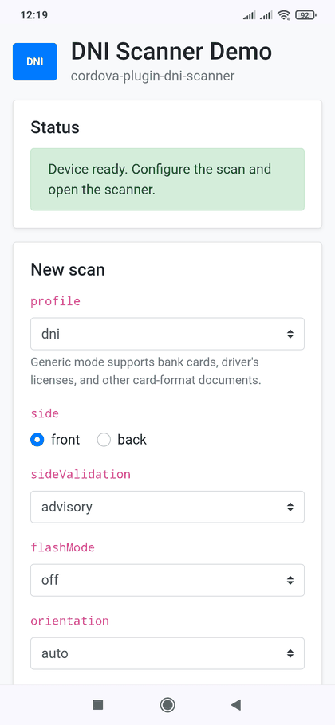

   [](https://github.com/andreszs/cordova-plugin-demos/tree/main/com.andreszs.dniscanner.demo) 

# cordova-plugin-dni-scanner

Android and iOS Cordova plugin for automatic or manual capture of the front or back of an Argentine DNI. It detects and tracks the card, evaluates capture quality, and returns a pixel-preserving cropped color JPEG without perspective warping or corrective rotation. Processing is fully local and works offline; the plugin does not use Google Play Services, ML Kit, Firebase, remote models, analytics, or remote APIs.

> [!TIP]
> **Want to try it first?** The [`cordova-plugin-demos`](https://github.com/andreszs/cordova-plugin-demos) repository includes a [ready-to-build Android and iOS DNI Scanner demo](https://github.com/andreszs/cordova-plugin-demos/tree/main/com.andreszs.dniscanner.demo) with every capture option and quality check exposed in the UI.

> Status: functional implementation under active calibration. Recognition and quality thresholds should be validated with a representative DNI and device matrix before production use.

## Table of contents

- [Screenshots](#screenshots)
- [Compatibility](#compatibility)
- [Installation](#installation)
- [Demo app](#demo-app)
- [Usage](#usage)
  - [Options](#options)
  - [Optional checks](#optional-checks)
- [Result](#result)
  - [Metadata](#metadata)
- [Cancellation, retries, and errors](#cancellation-retries-and-errors)
- [Architecture and behavior](#architecture-and-behavior)
- [Dependencies and licenses](#dependencies-and-licenses)
- [Privacy](#privacy)
- [Known limitations](#known-limitations)
- [Tests](#tests)

## Screenshots

The following images show the companion [`com.andreszs.dniscanner.demo`](https://github.com/andreszs/cordova-plugin-demos/tree/main/com.andreszs.dniscanner.demo) application, its configuration and quality controls, native automatic capture, and the cropped result.

<table>
  <tr>
    <td align="center" width="33%">
      <br>
      <sub>Configuration and quality controls</sub>
    </td>
    <td align="center" width="33%">
      <br>
      <sub>Native automatic capture</sub>
    </td>
    <td align="center" width="33%">
      <br>
      <sub>Cropped result</sub>
    </td>
  </tr>
</table>

## Compatibility

The plugin requires `cordova-android` 15.x, JDK 17, and the corresponding Android SDK toolchain.

| cordova-android | CameraX | Reference toolchain |
| --- | --- | --- |
| 15.x | 1.6.0 | compileSdk 36 / AGP 8.10.1 / JDK 17 |

Unknown Android toolchain combinations fail at build time rather than silently selecting an unsafe dependency version.

The iOS implementation supports `cordova-ios` 8.x and requires iOS 15.5 or newer. It uses only Apple system frameworks, including AVFoundation, Core Motion, Core Image, Vision, UIKit, and WebKit.

## Installation

Install from npm:

```bash
cordova plugin add cordova-plugin-dni-scanner
```

Or install directly from GitHub:

```bash
cordova plugin add https://github.com/andreszs/cordova-plugin-dni-scanner.git
```

The plugin requests only `CAMERA`. Images are written to the application's private cache, so no storage permission is required.

On iOS, the host app must provide a camera-purpose string in `config.xml`:

```xml
<platform name="ios">
    <preference name="deployment-target" value="15.5" />
    <edit-config file="*-Info.plist" mode="merge" target="NSCameraUsageDescription">
        <string>Usamos la cámara para escanear el DNI.</string>
    </edit-config>
</platform>
```

No Photo Library permission is required. Cropped JPEGs remain in the app's private cache and are exposed to the Cordova WebView through its own local scheme.

## Demo app

The companion project is part of the public [`cordova-plugin-demos`](https://github.com/andreszs/cordova-plugin-demos) repository. Open [`com.andreszs.dniscanner.demo`](https://github.com/andreszs/cordova-plugin-demos/tree/main/com.andreszs.dniscanner.demo) for installation and device deployment instructions.

The demo supports Android and iOS, exposes every scan option and quality check, displays the cropped JPEG and complete result payload, and can enable the native diagnostic overlay. Camera capture must be validated on a physical device.

## Usage

`DniScanner.scan(options)` returns a Promise:

```javascript
const result = await DniScanner.scan({
    profile: "dni",
    side: "front",
    sideValidation: "off",
    orientation: "auto",
    flashMode: "off",
    showCloseButton: true,
    showFlashButton: false,
    debugMode: false,
    beepEnabled: true,
    autoCapture: true,
    preferredCaptureLongEdge: 2048,
    maxOutputLongEdge: 1280,
    minEffectiveDocumentLongEdge: 1000,
    minStillSharpnessVariance: 158,
    instructionText: "Ubicá el frente del DNI en el recuadro",
    checks: {
        glare: true,
        shadows: true,
        edgeOcclusion: true
    },
    timeoutMs: 45000
});

if (result.status === "cancelled") {
    return;
}

document.querySelector("img").src = result.imageUri;
```

Use `side: "back"` to capture the back.

The dotted rectangle is an aiming guide rather than a hard crop boundary. A DNI
may extend slightly beyond it on any side; both platforms apply a 6% outward
tolerance while still requiring all four physical edges and enough source-image
clearance for the pixel-preserving crop.

For a credit/debit card, driver's license, or another ISO ID-1-sized card, use the
content-agnostic profile:

```javascript
const result = await DniScanner.scan({
    profile: "genericCard",
    side: "any",
    sideValidation: "off",
    instructionText: "Enmarcá la tarjeta dentro del recuadro"
});
```

This profile keeps geometric detection, crop completeness, perspective, focus,
exposure, motion, and severe reflection/shadow checks. It does not run DNI
side/variant recognition, and it avoids treating printed colors as skin or edge
obstructions.

### Options

| Option | Type | Default | Description |
| --- | --- | --- | --- |
| `profile` | `"dni" \| "genericCard"` | `"dni"` | `dni` enables optional DNI side/variant heuristics. `genericCard` accepts any ID-1-style card without inspecting its printed layout. |
| `side` | `"front" \| "back" \| "any"` | required | Use `front`/`back` with `dni`; use `any` with `genericCard`. |
| `sideValidation` | `"off" \| "advisory" \| "strict"` | `"off"` | Controls side recognition. `off` neither exposes nor enforces the heuristic side result, `advisory` returns the best-effort classification without blocking, and `strict` requires it to match `side`. |
| `autoCapture` | `boolean` | `true` | Enables automatic capture after a stable, focused track. Set it to `false` to use the native **Capturar** button only; the button also remains available as a fallback when automatic capture is enabled. |
| `orientation` | `"portrait" \| "landscape" \| "auto"` | `"portrait"` | Scanner orientation for this session. `auto` follows all four display rotations while scanning; capture briefly locks the current orientation. Fixed portrait and landscape modes follow both physical positions on Android and iOS. |
| `flashMode` | `"off" \| "auto" \| "on"` | `"off"` | Initial flash mode. `on` uses the torch; `off` is recommended to reduce reflections. |
| `showCloseButton` | `boolean` | `true` | Shows the native close button. Android Back still cancels when hidden. |
| `showFlashButton` | `boolean` | `true` | Shows the flash selector when the device has a flash unit. |
| `debugMode` | `boolean` | `false` | Shows the detected quadrilateral and live diagnostics in a small monospaced, translucent panel over the lower corner. Its fixed rows remain visible and use `-` while a metric is unavailable. Enabled checks are green inside their threshold and red outside it; disabled checks are gray. It never changes validation or camera layout. |
| `beepEnabled` | `boolean` | `true` | Plays a short synthesized confirmation beep after a successful capture. Device silent mode is respected. |
| `preferredCaptureLongEdge` | integer `1280–2048` | `1600` | Preferred long edge for the native camera capture. Each platform selects the closest supported size, preferring a higher resolution before falling back to a lower one. |
| `maxOutputLongEdge` | integer `640–2048` | `1280` | Independent maximum long edge of the cropped JPEG. The plugin never enlarges a document that contains fewer effective pixels. |
| `minEffectiveDocumentLongEdge` | integer `0–4096` | `0` | Minimum native-pixel long edge measured on the detected document. A smaller photo is discarded and capture resumes. Zero keeps the legacy behavior and disables this gate; `1000` is recommended when OCR detail matters. |
| `minStillSharpnessVariance` | number `1–10000` | Android `115`, iOS `70` | Minimum Laplacian variance of the cropped still photo when `checks.sharpness` is enabled. Defaults preserve each platform's previous behavior; use about `155–160` (for example `158`) for a stricter final-photo gate. |
| `instructionText` | `string \| null` | `""` | Optional text above the guide. Missing, empty, or `null` hides it. |
| `checks` | `object \| null` | standard checks enabled | Enables or disables individual acceptance checks. Missing properties stay enabled. |
| `timeoutMs` | integer `>= 0` | `0` | Maximum session duration. Zero disables the timeout. |

Only one scan may run at a time.

### Optional checks

`checks` accepts these boolean properties:

| Check | Purpose |
| --- | --- |
| `documentSize` | Rejects a card that is too close or too far. |
| `centering` | Requires the card near the guide. |
| `perspective` | Retained as an accepted compatibility flag. Geometry is mandatory: only a rectangle (with 1.5 degrees of detection tolerance) or a clean near-isosceles trapezoid (up to 8 degrees, with at most 2.5 degrees of symmetry error) is accepted, and in-plane rotation is limited to 2 degrees. |
| `stability` | Enables the longer stability hold and, when available, gyroscope and acceleration gating. A short multi-frame geometric confirmation remains mandatory when this check is disabled. |
| `sharpness` | Rejects blur using Laplacian variance. |
| `brightness` | Rejects under/overexposure and severe clipping. |
| `glare` | Rejects large localized reflections. |
| `shadows` | Rejects strong uneven illumination. |
| `edgeOcclusion` | Retained for API compatibility. The new detector always requires a complete four-corner document; it no longer runs the former color-based finger heuristic. |

Four-corner document detection, crop completeness, and the bounded symmetric-perspective rule are always required. Disabling another check reduces capture guarantees.

## Result

A successful scan resolves with metadata and a temporary JPEG:

```json
{
  "status": "success",
  "imageUri": "https://localhost/_dni_scanner_image_/dni-....jpg",
  "imagePath": "/data/user/0/.../cache/dni-scanner/dni-....jpg",
  "profile": "dni",
  "requestedSide": "front",
  "sideValidation": "off",
  "detectedSide": "unknown",
  "sideMatchesRequested": null,
  "variant": null,
  "documentCandidate": true,
  "usableForOcr": true,
  "contentScore": 0.86,
  "qualityWarnings": [],
  "confidence": {
    "document": 0.91,
    "content": 0.86,
    "side": 0.0,
    "variant": 0.0,
    "overall": 0.91
  },
  "rawWidth": 1920,
  "rawHeight": 1440,
  "effectiveDocumentLongEdge": 1534,
  "width": 1280,
  "height": 807,
  "preferredCaptureLongEdge": 2048,
  "maxOutputLongEdge": 1280,
  "minEffectiveDocumentLongEdge": 1000,
  "minStillSharpnessVariance": 158.0,
  "mimeType": "image/jpeg",
  "bytes": 613245,
  "quality": {
    "sharpness": 0.84,
    "sharpnessVariance": 184.27,
    "brightness": 0.56,
    "glare": 0.01,
    "perspective": 0.93,
    "darkClipping": 0.002,
    "highlightClipping": 0.03,
    "edgeGap": 0.02,
    "edgeObstruction": 0.0,
    "skinEdgeObstruction": 0.0,
    "illuminationSpread": 0.08,
    "shadowBoundary": 0.04
  },
  "motion": {
    "sensorAvailable": true,
    "gyroscopeAvailable": true,
    "accelerationAvailable": true,
    "sampling": true,
    "stable": true,
    "gyroscopeRadPerSecond": 0.018,
    "linearAcceleration": 0.074,
    "quietDurationMs": 824
  },
  "appliedChecks": {
    "documentSize": true,
    "centering": true,
    "perspective": true,
    "stability": true,
    "sharpness": true,
    "brightness": true,
    "glare": true,
    "shadows": true,
    "edgeOcclusion": true
  },
  "recognitionSignals": ["printed_content"],
  "perspectiveCorrected": false,
  "flashMode": "off",
  "orientation": "portrait",
  "orientationMode": "auto",
  "debugMode": false,
  "flashFired": false,
  "capturedAt": "2026-10-07T15:30:00.000Z"
}
```

### Metadata

| Field | Description |
| --- | --- |
| `status` | `"success"` for an accepted capture. Cancellation uses the separate result documented below. |
| `imageUri` | WebView-safe local URL. Use it directly as an `` source. |
| `imagePath` | Native absolute path to the same private-cache JPEG. |
| `profile` | Effective `"dni"` or `"genericCard"` scan profile. |
| `requestedSide` | Side requested by the application and used for scanner instructions. |
| `sideValidation` | Effective `"off"`, `"advisory"`, or `"strict"` policy. |
| `detectedSide` / `sideMatchesRequested` | Best-effort side result and comparison. With `off`, they are `"unknown"` and `null`. Only `strict` can reject a mismatch or unknown side. |
| `variant` | Best-effort generation estimate in `advisory` or `strict`; `null` with `off` or insufficient confidence. It never affects capture quality. |
| `documentCandidate` | `true` when a card-like quadrilateral was detected, safely cropped, and returned. It is not an authenticity result. |
| `usableForOcr` | Whether the final image meets permissive, non-configurable baseline exposure, focus, and severe-glare limits intended for downstream OCR. It does not block capture. |
| `contentScore` | Position-independent printed-texture score. It is diagnostic and never blocks capture. |
| `qualityWarnings` | Non-blocking warnings such as `low_sharpness`, `low_light`, `high_light`, `glare`, or `uneven_lighting`. With the sharpness check enabled, a value below `minStillSharpnessVariance` is recaptured instead of returned; `low_sharpness` can only be returned when that check is disabled. |
| `confidence` | `document`, `content`, optional `side`/`variant`, and `overall` heuristic scores. |
| `rawWidth` / `rawHeight` | Oriented native photograph dimensions before document detection, cropping, and output resizing. |
| `effectiveDocumentLongEdge` | Estimated native-pixel long edge of the detected document before cropping. It explains the useful source resolution and never causes upscaling. |
| `width` / `height` / `mimeType` / `bytes` | Encoded cropped-image properties. |
| `preferredCaptureLongEdge` | Requested native capture preference. The actual `rawWidth`/`rawHeight` depend on camera-supported sizes. |
| `maxOutputLongEdge` | Effective output-size limit requested for this scan. The actual long edge can be smaller. |
| `minEffectiveDocumentLongEdge` | Effective minimum useful source resolution. A successful result always meets it unless the value is zero (disabled). |
| `minStillSharpnessVariance` | Effective raw Laplacian-variance threshold applied to the cropped still photo. |
| `quality` | Normalized final-image measurements listed below. |
| `motion` | Inertial-sensor availability, sampling state, filtered rotation/acceleration, and quiet duration at capture. Measurements are `null` when unavailable; missing or inactive sensors fall back to visual stability. |
| `appliedChecks` | Effective checks used for the scan. These are configuration flags, not scores. |
| `recognitionSignals` | Supporting layout features; no code or personal text is decoded. |
| `perspectiveCorrected` | Always `false`: the plugin preserves the captured geometry and performs no homography or corrective rotation. |
| `flashMode` / `orientation` / `autoCapture` / `debugMode` | Effective session configuration. `orientation` is the physical orientation used for the accepted photo. |
| `orientationMode` | Requested orientation mode: `"portrait"`, `"landscape"`, or `"auto"`. |
| `flashFired` | `true`/`false`, or `null` in automatic mode where CameraX cannot report it reliably. |
| `capturedAt` | ISO 8601 UTC completion timestamp. |

All confidence and quality numbers are rounded to four decimals and are diagnostic heuristics, not identity, authenticity, or probability scores.

| Quality field | Meaning |
| --- | --- |
| `sharpness` | Backward-compatible normalized focus score; higher is better. |
| `sharpnessVariance` | Raw final-photo Laplacian variance, directly comparable with `minStillSharpnessVariance`. |
| `brightness` | Mean normalized luminance; it must remain within an acceptable range. |
| `glare` | Localized reflection coverage; lower is better. |
| `perspective` | Geometric regularity; higher is better. |
| `darkClipping` / `highlightClipping` | Fractions of very dark or very bright pixels. |
| `edgeGap` / `edgeObstruction` / `skinEdgeObstruction` | Reserved compatibility fields. The redesigned detector validates complete document geometry directly and currently returns zero for these legacy diagnostics. |
| `illuminationSpread` / `shadowBoundary` | Uneven-lighting measurements; lower is better. |

Possible DNI `recognitionSignals` are `printed_content`, `layout_signature`, `machine_readable_rows`, `square_dense_region`, `wide_dense_region`, and `localized_lower_right_dense_region`. With `sideValidation: "off"`, only the position-independent `printed_content` signal is exposed. `genericCard` returns an empty list. These are supporting observations, not decoded QR, PDF417, MRZ, or personal data.

Both image locations are temporary. Copy the file to application-managed persistent storage if it must be retained.

## Cancellation, retries, and errors

User cancellation resolves rather than rejects:

```json
{ "status": "cancelled", "reason": "user" }
```

Other failures reject with `{ code, message, recoverable }`:

| Code | Meaning |
| --- | --- |
| `INVALID_ARGUMENT` | Invalid or unsupported options. |
| `BUSY` | Another scan is active. |
| `CAMERA_PERMISSION_DENIED` | Camera permission was denied. |
| `CAMERA_UNAVAILABLE` | The rear camera is missing or could not be opened/configured. |
| `DETECTION_TIMEOUT` | No acceptable image was obtained before `timeoutMs`. |
| `CAPTURE_FAILED` | CameraX could not save the photograph. |
| `PROCESSING_FAILED` | Non-retryable local failure while decoding, cropping, encoding, writing, or returning the result. |
| `UNKNOWN` | Unstructured native error normalized by the JavaScript wrapper. |

Quality rejection does not produce `PROCESSING_FAILED`; the image is discarded and capture resumes. This includes a final document below `minEffectiveDocumentLongEdge` and `low_sharpness` below `minStillSharpnessVariance`. Side recognition never rejects in `off` or `advisory`. In `strict`, an unknown or mismatched side is also discarded and scanning resumes. The session ends on success, cancellation, a non-retryable failure, or `DETECTION_TIMEOUT`. With `timeoutMs: 0`, retryable rejection can continue indefinitely.

## Architecture and behavior

- Android uses CameraX `Preview`, `ImageAnalysis`, and `ImageCapture`. A bundled OpenCV engine runs contour proposals from Canny, difference-of-Gaussians, CLAHE, and adaptive-threshold strategies. Candidates must have evidence on all four sides and are ranked against the guide and the active track.
- Android follows the chosen quadrilateral with pyramidal Lucas-Kanade optical flow, periodically anchors it with a full contour pass, smooths corner motion, and measures stability from normalized displacement, area change, and elapsed time.
- iOS uses `AVCaptureVideoPreviewLayer`, `AVCaptureVideoDataOutput`, and `AVCapturePhotoOutput`. `VNDetectDocumentSegmentationRequest` is the primary detector, `VNDetectRectanglesRequest` is the native fallback, and `VNTrackRectangleRequest` maintains the document between full detections.
- Both platforms analyze reduced preview frames away from the UI thread, start AF/AE while the track is settling, keep analysis active through focusing, revalidate fresh geometry before the shutter, and expose a manual capture button.
- On iOS, the analysis frame is center-cropped to the same aspect-fill viewport shown by the camera preview. The accepted region is derived from the visible dotted guide, so size, centering, and boundary checks refer to what the user actually sees.
- The dotted guide has a 6% outward tolerance on Android and iOS. This lets users align a DNI directly with the guide even when hand framing leaves a few pixels outside it; mandatory crop-integrity checks still reject a document actually truncated by the camera source.
- Framing, perspective, in-plane alignment, stability, focus, exposure, glare, shadows, and edge obstruction are checked before capture and rechecked on the photograph. The returned JPEG is an axis-aligned bounding crop with a 6% safety margin; it does not straighten or warp the detected quadrilateral.
- Exposure validation treats pale DNI v1/v2 stock separately from true overexposure: `Demasiada luz` requires both a very high document-wide mean luminance and more than 65% highlight clipping. A locally blown reflection remains independently rejectable as glare, so white paper no longer fails solely because much of its surface is naturally bright.
- When `checks.stability` is enabled, Android uses the device gyroscope and acceleration sensors while iOS samples rotation and user acceleration through Core Motion at approximately 50 Hz. Movement blocks analysis and the shutter; once a JPEG exists, measured image sharpness decides whether it is accepted instead of a later transient sensor spike. Missing, late, or stale sensors fall back to visual stability instead of blocking capture.
- Android always confirms a compatible quadrilateral across several frames, even when `checks.stability` is disabled. Disabling stability skips the longer hold and sensor gate; it no longer permits capture from one isolated detection.
- Android crop integrity is mandatory: every detected side must leave enough source-image clearance for an independent outward safety margin. A capture that would clamp or lose any edge is discarded and scanning resumes.
- Stable valid frames trigger center-of-document focus and exposure metering. The UI distinguishes `Enfocando…`, `Tomando foto`, and `Procesando imagen…`: capture proceeds as soon as AF/AE settles or after a bounded 700 ms fallback, and the live camera preview remains visible while local validation runs so retryable rejection can continue without a visual interruption or camera-session restart.
- `preferredCaptureLongEdge` controls the native capture target (1600 px by default; `2048` is supported with CameraX's closest-higher-then-lower fallback), while `maxOutputLongEdge` independently caps the cropped JPEG at 1280 px by default. JPEG quality remains 95 and a low-resolution document is never enlarged. Colors and captured geometry are preserved without paper-scanner filters.
- In landscape, the guide uses 80% of the viewport height. Instruction and status messages move inside the top and bottom of the guide so they do not reserve vertical capture space.
- In the default `dni` profile, a position-independent printed-content score is returned for downstream diagnostics and never blocks capture. In `advisory` or `strict`, a compact 4×3 edge/saturation classifier also estimates side and generation; those estimates remain heuristic and variant never blocks capture. The `genericCard` profile skips those content heuristics and applies quality thresholds suited to visually diverse ID-1 cards.

The main status message and dotted guide always use the same ML Kit Face Capture palette: green (`#4ADE80`) means the current position is correct and is being stabilized, captured, or processed; yellow (`#FACC15`) means an actionable adjustment is still needed or AF/AE is currently focusing; red (`#EF4444`) means no usable candidate is present or a failed attempt has restarted. Live instruction changes are confirmed for 500 ms to remain readable. A failed-still message and its red guide are frozen for 1000 ms before returning to live search, matching Face Capture's default retry feedback. Built-in scanner messages are currently in Spanish. `debugMode` is disabled by default; when enabled, it adds the detected quadrilateral and a lower-corner diagnostic overlay without moving or resizing any scanner UI. The overlay reports detector source/state, frame size, candidate score/aspect/area, rectangularity/perspective, quality, visual stability, validation gates, and device movement. Debug values use green for accepted, red for rejected, and gray for disabled, unavailable, or not yet sampling.

A five-segment progress indicator mirrors ML Kit Face Capture without changing capture gates: document detection, framing/perspective, visual quality, stability, and final capture. Completed stages are green, the current stage is yellow, and future stages are translucent white, with the same 260 ms color transition. A tracking interruption shorter than 300 ms does not regress visible progress. The fifth segment uses intermediate green (`#A2D54B`) during `Tomando foto` and `Procesando imagen…`, because final-photo validation can still reject the attempt. Only an accepted result turns all five segments fully green and displays the same `✓ Listo` final message as Face Capture for 260 ms before returning to Cordova. In portrait, the instruction label, dotted guide, progress bar, and status label use matching vertical gaps. The diagnostic panel remains an independent absolute overlay and may overlap them without affecting scanner geometry.

An iOS landscape session supports both `landscapeLeft` and `landscapeRight`. The preview, analyzed frames, captured photo, overlay, and controls update together when the device is rotated 180 degrees.

The default `sideValidation: "off"` prioritizes capture recall: printing offsets, wear, dirt, layout differences, unknown side, and low side/variant confidence do not reject an otherwise usable card image. `advisory` returns the classification without changing acceptance. Only `strict` discards an opposite or unknown side and displays the red correction message before analysis resumes.

## Dependencies and licenses

| Dependency | Version | License | Purpose |
| --- | --- | --- | --- |
| AndroidX CameraX (`core`, `camera2`, `lifecycle`, `view`) | compatibility table | Apache-2.0 | Preview, analysis, and capture. |
| OpenCV Android | 4.12.0 | Apache-2.0 | Local contour detection, optical-flow tracking, and quality measurement. |
| AndroidX ExifInterface | 1.3.2 | Apache-2.0 | JPEG orientation metadata. |
| Guava `listenablefuture` | 1.0 | Apache-2.0 | Minimal local type required by CameraX; no Google service or network dependency. |
| AndroidX WebKit | supplied by Cordova | Apache-2.0 | Serves the private JPEG to the WebView; declared `compileOnly`. |
| Apple AVFoundation / Core Motion / Core Image / Vision / WebKit | iOS system | Apple SDK | Camera, motion stability, rectangle detection, pixel-preserving cropping, and private JPEG delivery. |

The unused CameraX video stack is excluded. The plugin contains no downloadable models or remote-service SDKs. Plugin source is licensed under MIT; third-party notices are recorded in [THIRD_PARTY_NOTICES.md](THIRD_PARTY_NOTICES.md).

## Privacy

- Fully local and offline processing.
- No Internet permission, uploads, analytics, telemetry, tracking, or crash reporting.
- No Google Play Services or runtime model downloads.
- No shared-storage permission; output remains in the application's private cache.
- The iOS package includes a privacy manifest and uses only the camera-purpose string supplied by the host application. Core Motion does not add a permission prompt for this use.

## Known limitations

- `documentCandidate` and `contentScore` describe card-like geometry and printed texture; they do not prove DNI identity or authenticity. Use downstream OCR or business validation when that distinction is required.
- Side and generation estimates in `advisory` and `strict` are heuristic and based on a limited reference/calibration set.
- Glare, shadow, and hand/edge detection are heuristic and may require further device calibration.
- Camera and recognition thresholds may require additional calibration across representative devices and DNI samples.
- QR and PDF417 are not decoded, and no Base64 result is produced.
- Fixed portrait or landscape mode keeps that orientation family for the scan and follows both physical positions; `auto` follows all four display rotations. EXIF camera orientation is normalized, but document roll, perspective, and upside-down placement are never corrected after capture.
- Output is temporary cache data and has no plugin-managed retention policy.

## Tests

`npm test` verifies the public options, capture sizing, new native pipelines, tracking integration, AF/AE flow, manual capture, JPEG 95, no-upscale behavior, and platform requirements. Android is compiled through the cordova-android 15 demo. iOS must be compiled in simulator and device configurations on macOS. Reference DNI images are intentionally excluded from the repository and npm package; physical-device validation remains required before a production release.
